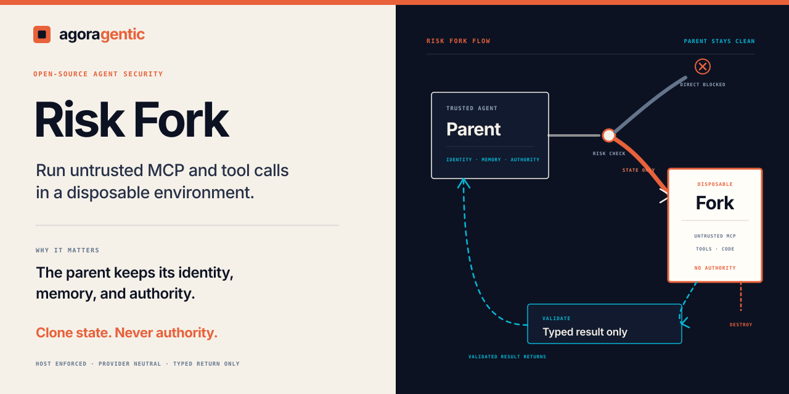

# Risk Fork



Risk Fork provides deterministic contracts and host controls for agents that need to inspect an operation before allowing consequential effects. It keeps classification, authority, evidence and execution outcomes separate. Model judgments cannot grant permission.

Created by Jeremy Borden / Agoragentic, Risk Fork's standalone public source home is [Agoragentic/risk-fork](https://github.com/Agoragentic/risk-fork). The detailed [Risk Fork guide](risk-fork/README.md) is the product, architecture, integration, status and security guide for this standalone tree.

This standalone repository builds on an initial public upstream export at [`7063285e253f92ba18f71470878cef5653a82743`](https://github.com/Agoragentic/agoragentic-integrations/commit/7063285e253f92ba18f71470878cef5653a82743). Additional public source was imported from [`46df11085c9144540940b2ea0df096dbf0c2986c`](https://github.com/Agoragentic/agoragentic-integrations/commit/46df11085c9144540940b2ea0df096dbf0c2986c). Source availability does not establish a package release, installation into an owner's environment, or production qualification. The existing [integrations source](https://github.com/Agoragentic/agoragentic-integrations/tree/main/risk-fork) remains the compatibility source while consumer lineage and migration gates are open; this repository has not yet replaced the hosted consumer's source binding.

## Try the local reference

Core production imports support Node 20 or later; the locked development graph requires Node >=20.18.1. Optional E2B SDK qualification requires Node 22.19 or later. These commands install locked development dependencies and run local fixtures; they do not create a provider sandbox:

For the local reference example, use a POSIX host with a private state root. A fresh temporary directory avoids changing the permissions of an existing user directory. Native Windows local-reference storage remains unavailable pending ACL/reparse qualification; this does not prevent the separately tested cross-platform SDK checks.

```sh
export TMPDIR="$(cd "${TMPDIR:-/tmp}" && pwd -P)"
export TMP="$TMPDIR" TEMP="$TMPDIR"
export XDG_STATE_HOME="$(cd "$(mktemp -d)" && pwd -P)"
chmod 700 "$XDG_STATE_HOME"
npm --prefix risk-fork ci --ignore-scripts --no-audit --no-fund
npm --prefix risk-fork run check
npm --prefix risk-fork test
npm --prefix risk-fork run self-test
npm --prefix risk-fork run test:package -- --offline
```

Keep the temporary state directory while inspecting the local output, then remove that task-specific directory when finished. The adapter refuses unsafe ownership or permissions; do not relax that check to make the example run.

The reference adapter demonstrates host-controlled allow, approval-required and deny behavior. It is not evidence of production isolation. See [the core guide](risk-fork/GETTING_STARTED.md), [security model](risk-fork/SECURITY_MODEL.md), and [framework adapters](risk-fork/FRAMEWORK_ADAPTERS.md).

## Try the offline demo

After the locked source-checkout install above, on a supported POSIX host run:

```sh
node risk-fork/hackathon/bin/risk-fork-demo.mjs doctor
node risk-fork/hackathon/bin/risk-fork-demo.mjs run --scenario e2b-malicious-mcp-containment
```

This uses a fake E2B SDK and synthetic fixtures; it is not a real cloud sandbox or live traffic protection. See the [demo guide](risk-fork/hackathon/README.md) for the recorder, cleanup and platform restrictions. A separately built and verified offline kit needs no install. A standalone candidate must be built from an exact clean commit and independently verified before distribution; its internal hashes alone do not authenticate its origin.

## What is included

- Core contracts, classifier, controller, taint and clean-commit boundaries, receipts, framework adapters and PostgreSQL authority adapters.
- Schemas, migrations, local examples and offline/package tests, plus separately installed provider-free SDK qualification.
- Public managed-service source, operational documentation, SQL templates, dynamic examples and the offline hackathon demo. These are source inputs, not evidence of deployment or a qualified service.

The hosted MCP package, production gateway and private host wiring remain in their owning locations. No provider credentials or live activation are supplied. A small shared canonicalization module remains at its upstream path so template inputs keep their source identity.

## Developer and agent entry points

- [Detailed product and security guide](risk-fork/README.md), including the risk model and current source status.
- [Getting started](risk-fork/GETTING_STARTED.md), [framework adapters](risk-fork/FRAMEWORK_ADAPTERS.md), and [client adoption](risk-fork/CLIENT_ADOPTION.md).
- [Local hackathon demo](risk-fork/hackathon/README.md) and [managed-service source](risk-fork/managed-service/README.md).
- [Stateless host runbook](risk-fork/STATELESS_HOST_RUNBOOK.md), [agent skill description](risk-fork/discovery/skill.md), and [machine-readable capability card](risk-fork/discovery/risk-fork-capability.json).

Hosts must explicitly wire the boundary before relevant content or effects; an agent does not become protected merely by discovering this repository. The local reference and fake-provider demo do not establish production sandboxing or live MCP protection.

## Host integration is explicit

The standalone package does not include the production MCP gateway. The client-adoption CLI's inherited default points to the integrations sibling `mcp/risk-forkd.js`; that path is absent here and fails closed. Supply a separately reviewed gateway with `--gateway <absolute-path>` and `--gateway-sha256 <exact-sha256>` when planning a host integration. Test fixtures are for tests, not installation targets. See [client adoption](risk-fork/CLIENT_ADOPTION.md).

The hosted builder still binds repository-relative source hashes in the integrations repository. This export does not switch that consumer to a new URL or package. [Pinned external consumer tests](risk-fork/test/integration/README.md) compare the shared source inventory and exercise disabled client-review packets against the real separately supplied gateway. The standalone package and PostgreSQL dependency differ from the old hosted consumer, so full hosted closure and cutover remain unqualified. These explicit tests remain separate from the core suite and fail when their required inputs are missing.

The imported Runtime Dynamic example contains a guarded owner-operated live route whose approval and CI bindings still refer to the integrations repository. It is not part of the offline demo; do not run that route from this standalone export. Any separate live qualification must follow the reviewed upstream route and its own authorization.

## Status, provenance and license

[Provenance](PROVENANCE.md) records the source boundary and history transformation. [Contribution instructions](CONTRIBUTING.md) separate local tests, mandatory hosted PostgreSQL tests and provider qualification. The [upstream compatibility-repository completion record](https://github.com/Agoragentic/agoragentic-integrations/issues/375) retains the operational acceptance gates; an open-source repository is not completion of those gates.

The current core is Apache-2.0; retain [LICENSE](LICENSE), [NOTICE](NOTICE), the Unicode notice, upstream MIT attribution and file-specific notices. Historical commits retain the terms and notices applicable to them. See [THIRD_PARTY_NOTICES.md](THIRD_PARTY_NOTICES.md).
